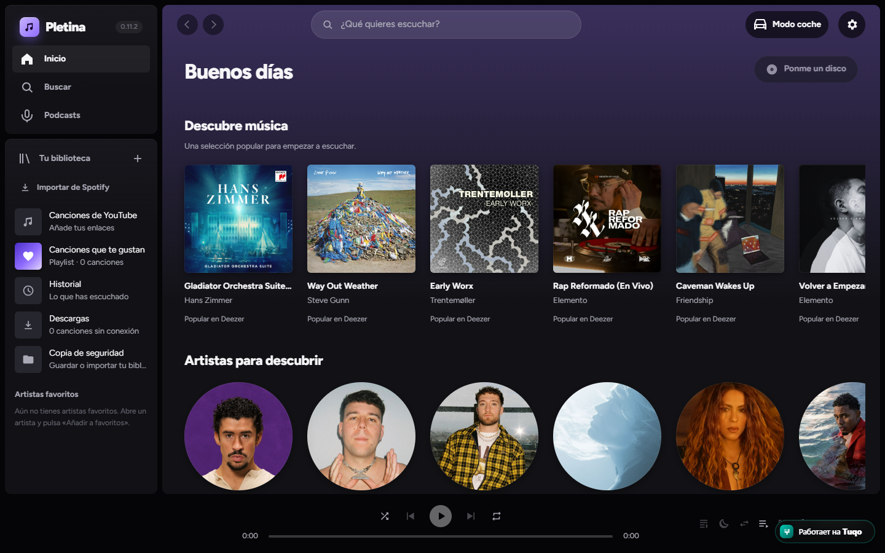
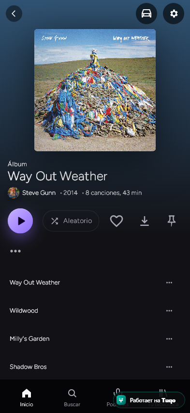
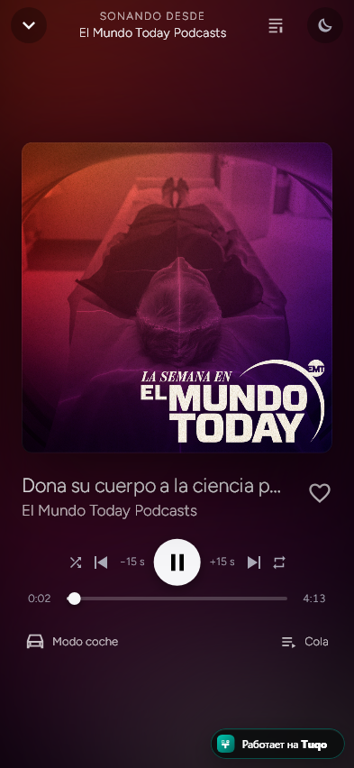
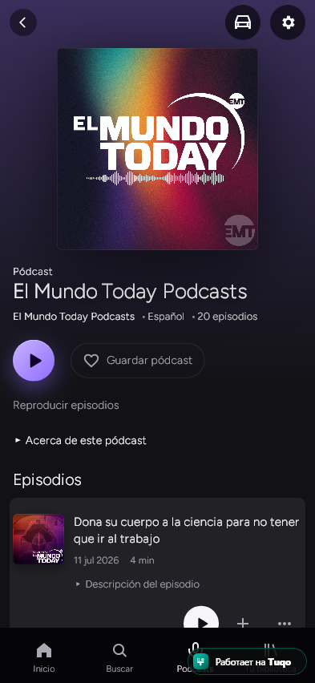

# Pletina

Música y pódcasts en una **app web para iPhone, iPad, Android, Windows, macOS y Linux**. Crea playlists, importa listas de Spotify y descarga el audio disponible para escucharlo sin conexión.

El desarrollo se centra en la app web (PWA). Por ahora, no hay nuevas versiones de la APK de Android previstas.

<p align="center">
  <strong><a href="https://pletina-app.tuqo.ru/">Abrir Pletina en Tuqo</a></strong>
  · <a href="#instalar-en-iphone-y-ipad">Instalar en iPhone y iPad</a>
  · <a href="#instaladores-nativos">Descargar instaladores nativos</a>
</p>



| Álbum | Sonando ahora | Pódcast |
| :---: | :---: | :---: |
|  |  |  |

*Capturas de la web en escritorio y en una vista emulada de iPhone.*

## Instalar en iPhone y iPad

1. Abre [Pletina en Safari](https://pletina-app.tuqo.ru/).
2. Toca **Compartir → Añadir a pantalla de inicio**.
3. Activa **Abrir como app web** si aparece y toca **Añadir**.

Puedes usar Pletina desde el navegador con **Probar sin instalar**. Si prefieres tener un icono en Android o en el ordenador, pulsa **Instalar Pletina** en Tuqo. [Guía de Apple para iPhone](https://support.apple.com/es-es/guide/iphone/iphea86e5236/ios).

### Llevar tu biblioteca a la web

En la versión nativa 0.13.0, exporta desde **Tu biblioteca → Llevar mi biblioteca a la web**. Si vienes de otra instalación web, usa **Tu biblioteca → Copia de seguridad**. Abre el icono nuevo de Pletina e importa el archivo en **Tu biblioteca → Copia de seguridad**.

Se trasladan favoritos, listas, historial y progreso de pódcasts. El audio descargado queda en la instalación anterior. [Notas de Pletina 0.13.0](https://github.com/diad87/pletina-releases/releases/tag/v0.13.0).

## Instaladores nativos

**[Descargar la última versión nativa publicada](https://github.com/diad87/pletina-releases/releases/latest)**

| Sistema | Instalador |
| --- | --- |
| Windows 10 y 11 | `_x64-setup.exe` |
| macOS 11 o posterior, Intel y Apple Silicon | `_universal.dmg` |
| Linux de 64 bits | `_amd64.AppImage` para distribuciones recientes o `_amd64.deb` para Debian y Ubuntu |
| Android 7 o posterior de 64 bits | `_android.apk`, con Android Auto |

**Android con Obtainium.** Instala [Obtainium](https://github.com/ImranR98/Obtainium), abre **Añadir app** y pega `https://github.com/diad87/pletina-releases`. Pulsa **Añadir** y después **Instalar**. Android te pedirá permiso para instalar desde Obtainium la primera vez.

<details>
<summary>Primera instalación</summary>

- En Windows, si aparece el aviso del sistema, elige **Más información → Ejecutar de todas formas**.
- En macOS, arrastra Pletina a **Aplicaciones**. Si aparece un aviso, abre la app con clic derecho y **Abrir**.
- Si venías de Musify, Pletina conserva tu biblioteca al actualizar.

</details>

<details>
<summary>Comprobar que una descarga es auténtica</summary>

Con la [CLI de GitHub](https://cli.github.com/), verifica que el archivo procede del repositorio de Pletina.

```bash
gh attestation verify Pletina_0.13.0_x64-setup.exe --repo diad87/pletina
```

Usa el nombre del archivo que descargaste. Puedes comprobar su huella con `sha256sum -c SHA256SUMS.txt` en Linux, `shasum -a 256 -c SHA256SUMS.txt` en macOS o `Get-FileHash` en Windows y comparar con el archivo de la versión.

</details>

[Código fuente](https://github.com/diad87/pletina) · [Licencia GPL-3.0](https://github.com/diad87/pletina/blob/main/LICENSE) · [Privacidad](https://github.com/diad87/pletina#privacidad)
